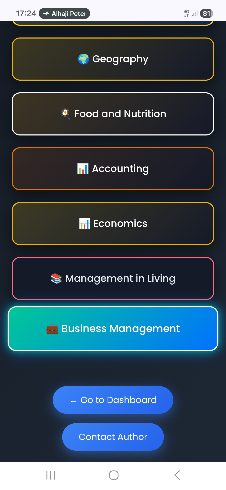
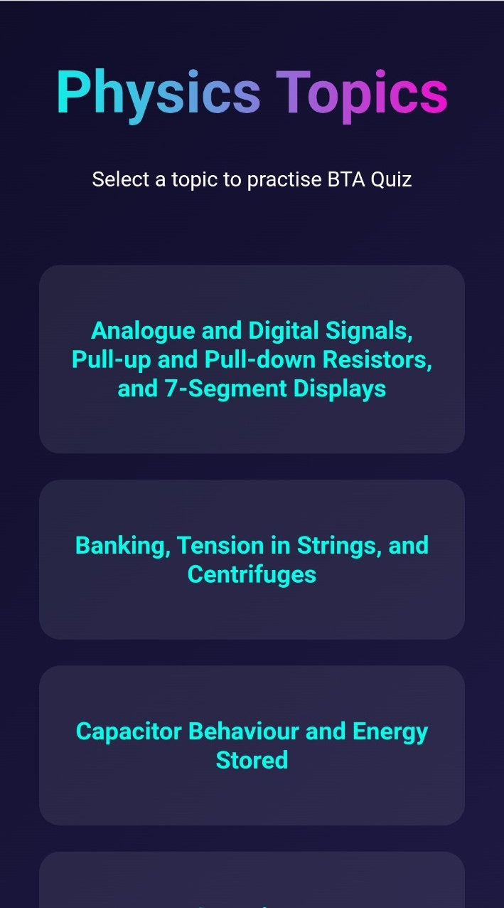
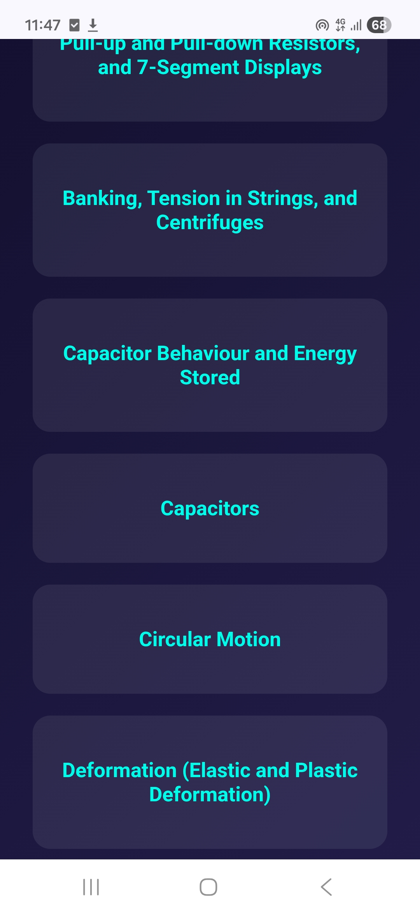
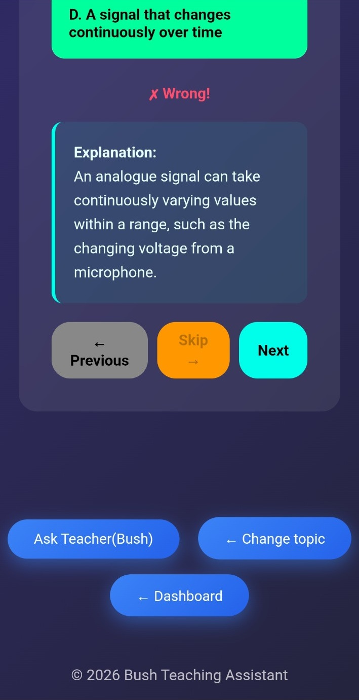
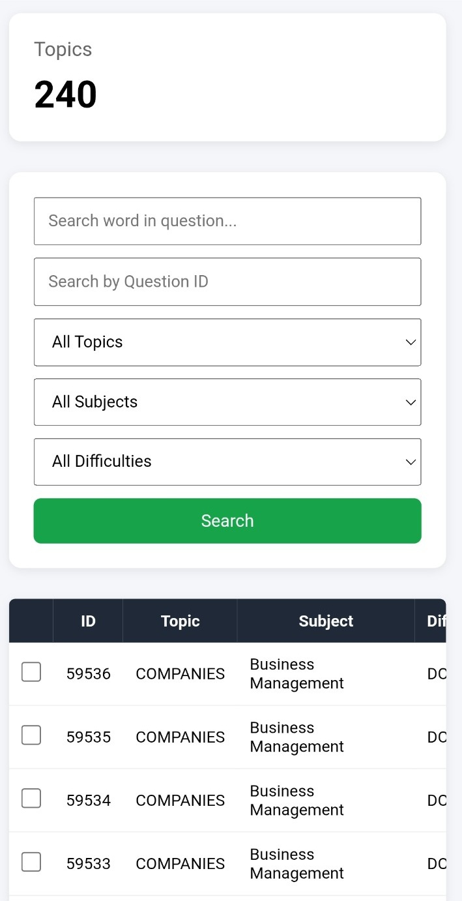
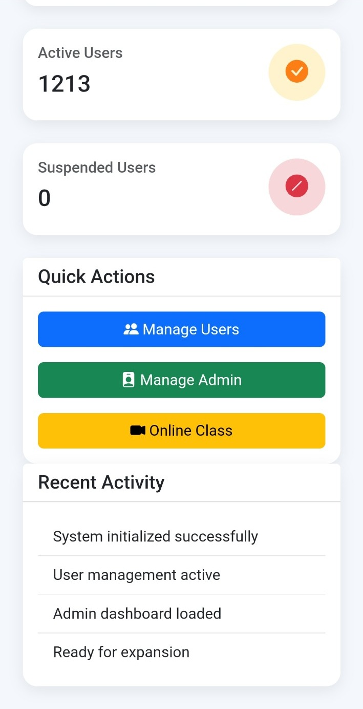

# Bush Teaching Assistant (BTA)

**A Full-Stack Educational Technology Platform Built with Python and Flask**

- **Live application:** https://bta-330.onrender.com
- **Developer:** Emmanuel Asiamah Amponsah
- **Status:** Live and actively maintained

---

## 1. Project Overview

Bush Teaching Assistant (BTA) is a full-stack educational technology platform developed to support Ghanaian Senior High School (SHS) students in examination preparation through interactive quizzes, subject- and topic-based practice questions, immediate feedback, and digital learning resources.

The platform provides students with a digital learning environment and gives administrators tools to manage educational content and platform activities. BTA is a live application used by students and is independently designed, developed, deployed, and maintained.

## 2. Problem and Purpose

BTA aims to make examination practice and digital learning resources more accessible to Ghanaian SHS students. Students can select subjects and topics, practise questions, receive feedback and explanations, and use the platform to support their learning.

## 3. Key Features

### Student Learning
- Student registration and login.
- Personalised student dashboard.
- Subject and topic selection.
- Interactive multiple-choice quizzes.
- Randomised question selection.
- Automatic answer evaluation.
- Immediate feedback and explanations.
- Quiz history and performance tracking.

### Question Bank Management
- Create, edit, and delete questions.
- Organise questions by subject and topic.
- Add answer options and explanations.
- Categorise questions by difficulty.
- Search and filter questions.
- Bulk question upload.
- Export questions for backup.

### Administration
- Student and administrator management.
- Subject and question administration.
- Administrative dashboards.
- Online class management.
- Announcements and learning activities.

### Extra Classes
- Student enrolment management.
- Parent and teacher management.
- Subject-based class management.
- Monthly fee management.
- Payment processing and transaction tracking.

### Online Learning
- Virtual class management.
- Class availability monitoring.
- Google Meet integration.
- Teacher-led learning activities.

## 4. Technology Stack

| Technology | Purpose |
|---|---|
| Python | Primary programming language |
| Flask | Backend web framework |
| SQLAlchemy | Object-relational mapping |
| PostgreSQL | Relational database |
| Flask-Migrate | Database migration management |
| Alembic | Database schema versioning |
| HTML5 | Web page structure |
| CSS3 | Styling and responsive interfaces |
| JavaScript | Frontend interactions |
| Supabase | Managed PostgreSQL database |
| Render | Application hosting |
| Paystack | Payment processing |
| Git | Version control |
| GitHub | Source code hosting |

## 5. System Architecture

BTA uses a modular full-stack web application architecture. The frontend provides interfaces for students and administrators, the Flask backend handles application logic and database operations, and PostgreSQL stores application data.

```text
                         BTA USERS
                             |
              -----------------------------
              |             |             |
           Students      Teachers       Admins
              |             |             |
              -----------------------------
                             |
                       WEB INTERFACE
                       HTML, CSS, JS
                             |
                       FLASK BACKEND
                          PYTHON
                             |
              -----------------------------
              |             |             |
           Database      Payments    Online Classes
              |             |             |
           Supabase      Paystack     Google Meet
              |
          PostgreSQL
```

### Backend Responsibilities
- Authentication and authorisation.
- Application routing and business logic.
- API endpoints.
- Database operations.
- Assessment processing.
- Administrative operations.
- Payment-related operations.

### External Services
- **Render:** Hosting the Flask application.
- **Supabase:** PostgreSQL database hosting.
- **Paystack:** Payment processing.
- **Google Meet:** Virtual classroom access.

## 6. Database

BTA uses PostgreSQL as its relational database, with SQLAlchemy for ORM-based database interactions. Flask-Migrate and Alembic are used to manage database schema changes.

The database supports application areas such as users, subjects, questions, student progress, quiz history, assignments, announcements, live classes, Extra Classes enrolments, fees, and payment transactions.

## 7. Payment System

The Extra Classes module integrates Paystack for online payment processing. The system includes monthly class fee management, student and parent payment records, transaction references, payment status tracking, and payment item records.

## 8. Application Screenshots

The screenshots below show key parts of BTA, from the student dashboard and subject navigation to quizzes and administrative question management.

### Student Dashboard


### Subject Selection




### Physics Topic Selection





### Quiz Experience




### Question Bank




### Super Administrator Dashboard



## 9. Project Structure

The application follows a modular Flask structure. The main folders and files include:

```text
bta-production-architecture/
│
├── app/
│   ├── models/
│   ├── routes/
│   ├── admin/
│   ├── utils/
│   ├── templates/
│   └── static/
│
├── migrations/
├── docs/
│   └── screenshots/
├── requirements.txt
├── run.py
└── README.md
```

This is a high-level illustration; additional modules and files may exist in the repository.

## 10. Installation and Local Development

### Prerequisites
- Python 3.10 or later.
- PostgreSQL.
- Git.
- pip.

### Step 1: Clone the Repository

```bash
git clone https://github.com/Bushsmith3300/bta-production-architecture.git
```

### Step 2: Enter the Project Directory

```bash
cd bta-production-architecture
```

### Step 3: Create and Activate a Virtual Environment

```bash
python -m venv venv
```

**Windows:**

```bash
venv\\Scripts\\activate
```

**Linux/macOS:**

```bash
source venv/bin/activate
```

### Step 4: Install Dependencies

```bash
pip install -r requirements.txt
```

### Step 5: Configure Environment Variables

Configure the environment variables required by the application. For example:

```env
SECRET_KEY=your_secret_key
DATABASE_URL=your_database_connection_string
```

Additional configuration may be required for payment processing and other integrations. Use development credentials locally. Never commit real credentials, passwords, API keys, or production secrets.

### Step 6: Configure the Database and Run Migrations

Configure PostgreSQL and ensure the application has the correct database connection settings. Then run:

```bash
flask db upgrade
```

### Step 7: Start the Application

```bash
python run.py
```

The application will start using its configured development server settings.

> Local setup may require additional environment variables or configuration depending on the deployment settings.

## 11. Deployment

BTA is deployed using cloud infrastructure and integrated services.

| Service | Responsibility |
|---|---|
| Render | Hosting the Flask application |
| Supabase | PostgreSQL database hosting |
| Paystack | Payment processing |
| GitHub | Source code and version control |

The production environment is configured separately from local development.

## 12. Security and Data Protection

Security is an important consideration in the development of BTA. The application incorporates authentication, access control, database management, and secure configuration practices.

Production credentials, database passwords, payment gateway secret keys, and sensitive student information must never be exposed in public repositories.

## 13. Continuous Development

BTA is actively maintained. Ongoing development focuses on:
- Expanding educational content across additional SHS subjects.
- Improving student learning analytics.
- Enhancing assessment functionality.
- Improving application performance.
- Expanding educational and administrative features.
- Maintaining database integrity and application security.

## 14. Developer

**Emmanuel Asiamah Amponsah**  
**Professional title:** Python Software Developer  
**Education:** BSc Petroleum Engineering  

**Project:** Founder and Lead Developer of Bush Teaching Assistant (BTA)  
**GitHub username:** Bushsmith3300  
**GitHub profile:** https://github.com/Bushsmith3300  

*Building technology to make quality education and examination preparation more accessible to Ghanaian students.*
