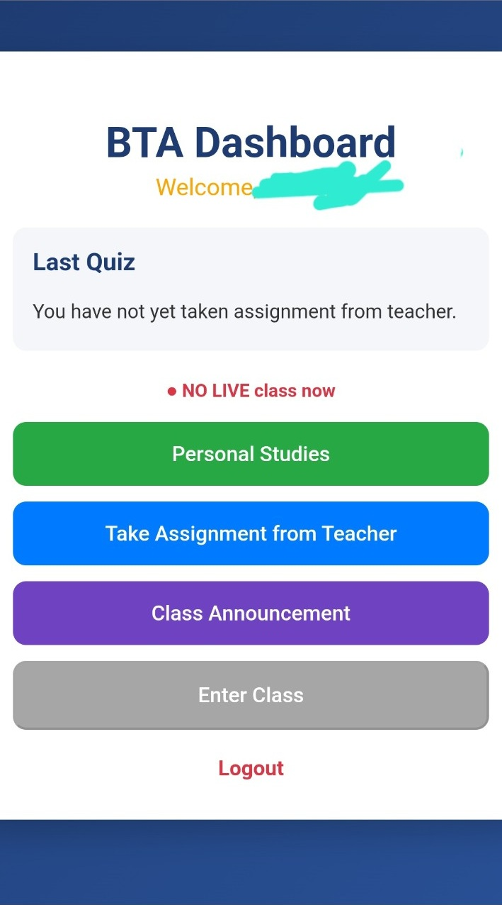
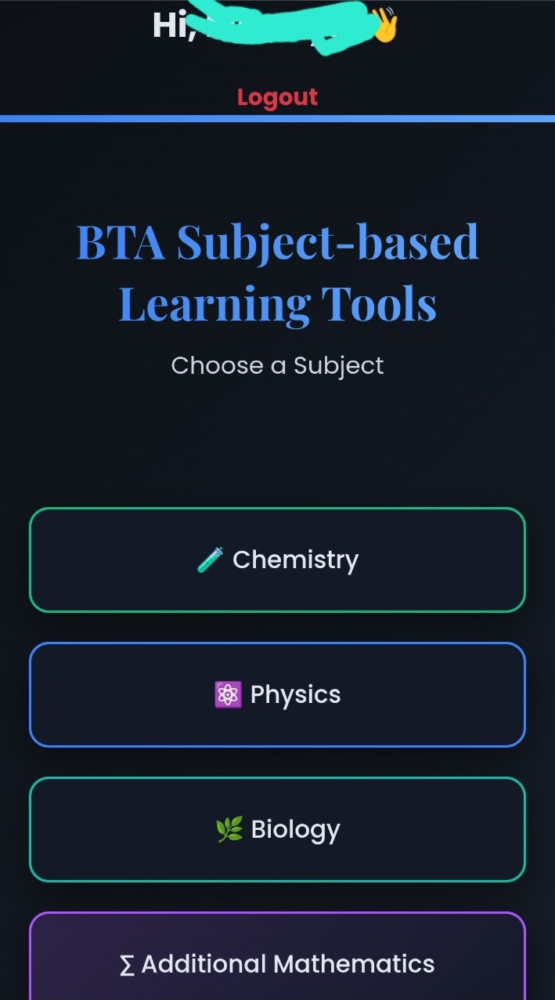
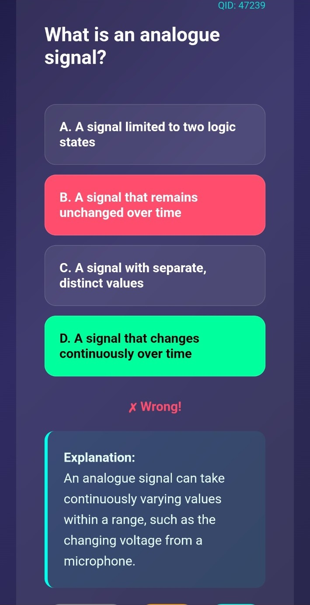
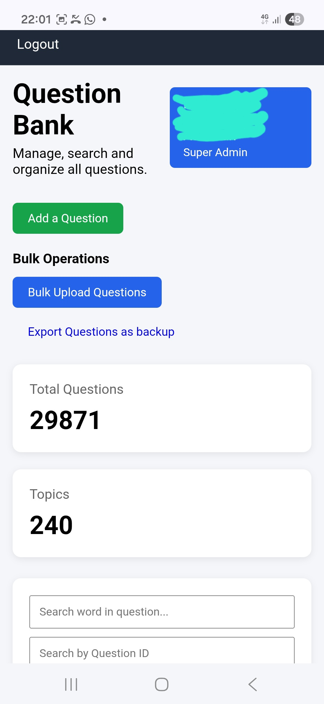

# Bush Teaching Assistant (BTA)

A Full-Stack Educational Technology Platform Built with Python and Flask

**Live Application:** https://bta-330.onrender.com

**Developer:** Emmanuel Asiamah Amponsah

**Project Status:** Live and Actively Maintained

---

## 1. Project Overview

Bush Teaching Assistant (BTA) is a full-stack educational technology platform developed to support Ghanaian Senior High School (SHS) students in preparing for examinations through interactive quizzes, topic-based practice questions, performance tracking and digital learning resources.

The platform provides students with an accessible digital learning environment while equipping administrators and teachers with tools to manage educational content, students, assignments and learning activities.

BTA is a live application currently being used by students.

The application is independently designed, developed, deployed and maintained.

## 2. Problem Statement

Access to quality examination practice questions and effective digital learning resources is important for students preparing for their examinations.

BTA addresses this need by providing a centralised educational platform where students can:

- Practise examination questions.
- Access multiple academic subjects.
- Take interactive quizzes.
- Receive immediate feedback and explanations.
- Monitor their academic progress.
- Participate in additional learning activities.

The platform is designed around the Ghanaian Senior High School educational environment.

## 3. Key Features

### Student Management

- Student registration and login.
- Secure password handling.
- Session-based authentication.
- Personalised student dashboards.
- Student account management.

### Interactive Assessment System

- Subject-based learning.
- Topic-based quizzes.
- Multiple-choice questions.
- Randomised question selection.
- Automatic answer evaluation.
- Immediate feedback and explanations.
- Quiz history and performance tracking.

### Question Management

- Create, edit and delete examination questions.
- Organise questions by subject and topic.
- Manage answer options and explanations.
- Categorise questions by difficulty.
- Bulk question uploads.
- Question searching and filtering.
- Question export functionality.

### Administrative Management

- Student management.
- Administrator management.
- Subject management.
- Question administration.
- Announcement management.
- Online class management.
- Administrative dashboards and reporting.

### Extra Classes Management

- Student enrolment management.
- Parent management.
- Teacher management.
- Subject-based class management.
- Monthly fee management.
- Payment processing.
- Payment transaction tracking.

### Online Learning

- Virtual class management.
- Class availability monitoring.
- Google Meet integration.
- Teacher-led learning activities.

## 4. Technology Stack

| Technology | Purpose |
|---|---|
| Python | Primary programming language |
| Flask | Backend web framework |
| SQLAlchemy | Object-relational mapping |
| PostgreSQL | Relational database |
| Flask-Migrate | Database migration management |
| Alembic | Database schema versioning |
| JavaScript | Frontend interactions |
| HTML5 | Web page structure |
| CSS3 | User interface styling |
| Supabase | Managed PostgreSQL database |
| Render | Application hosting |
| Paystack | Payment processing |
| Git | Version control |
| GitHub | Source code management |

## 5. System Architecture

BTA follows a modular full-stack web application architecture.

The system consists of frontend interfaces, backend application services, database infrastructure and external service integrations.

### Architecture Overview

```text
                         BTA USERS
                             |
              -----------------------------
              |             |             |
           Students      Teachers       Admins
              |             |             |
              -----------------------------
                             |
                       WEB INTERFACE
                       HTML, CSS, JS
                             |
                       FLASK BACKEND
                          PYTHON
                             |
              -----------------------------
              |             |             |
           Database      Payments    Online Classes
              |             |             |
           Supabase      Paystack     Google Meet
              |
          PostgreSQL
              |
         APPLICATION DATA
```

### Frontend Layer

Provides the interfaces through which students, teachers and administrators interact with the application.

### Backend Layer

The Flask application handles:

- Authentication and authorisation.
- Application routing.
- Business logic.
- API endpoints.
- Database operations.
- Assessment processing.
- Administrative operations.
- Payment-related operations.

### Database Layer

PostgreSQL stores application information, including:

- User accounts.
- Subjects.
- Examination questions.
- Student progress.
- Quiz history.
- Assignments.
- Announcements.
- Extra classes.
- Payment records.

### External Integrations

The application integrates with external services to support additional functionality.

- Supabase: PostgreSQL database hosting.
- Paystack: Online payment processing.
- Google Meet: Virtual classroom access.
- Render: Application hosting.

## 6. Database Architecture

BTA uses PostgreSQL as its primary relational database management system.

SQLAlchemy provides the ORM layer for database interactions.

Flask-Migrate and Alembic are used to manage database schema changes and migrations.

The database supports different application modules, including:

- User management.
- Subject management.
- Question management.
- Student progress tracking.
- Quiz history.
- Live classes and assessments.
- Assignments and submissions.
- Extra classes and enrolments.
- Monthly fees and payment transactions.

Database relationships and integrity constraints help maintain consistency across application records.

## 7. Payment System

The Extra Classes module incorporates Paystack for online payment processing.

The system supports:

- Monthly class fee management.
- Student and parent payment records.
- Payment transaction references.
- Payment status tracking.
- Payment item management.
- Teacher and subject-related payment records.

The payment integration is designed to support the financial operations of the Extra Classes module.

## 8. Application Screenshots

The following screenshots demonstrate different parts of the BTA application, including student learning interfaces, subject and topic selection, interactive quizzes and administrative tools.

### Student Dashboard



### Subject Selection



### Available Subjects


### Physics Topics


### Interactive Quiz Interface



### Question Management



### Super Administrator Dashboard


## 9. Project Structure

The application follows a modular Flask architecture.

```text
bta-production-architecture/
│
├── app/
│   ├── models/
│   ├── routes/
│   ├── admin/
│   ├── utils/
│   ├── templates/
│   └── static/
│
├── migrations/
│
├── docs/
│   └── screenshots/
│
├── populate_question_hashes.py
├── requirements.txt
├── run.py
└── README.md
```

The structure above illustrates the main application components. Additional files and subdirectories may exist within individual modules.

## 10. Installation and Local Development

### Prerequisites

- Python 3.10 or later.
- PostgreSQL.
- Git.
- pip.

### Step 1: Clone the Repository

```bash
git clone https://github.com/Bushsmith3300/bta-production-architecture.git
```

### Step 2: Navigate to the Project Directory

```bash
cd bta-production-architecture
```

### Step 3: Create a Virtual Environment

```bash
python -m venv venv
```

Activate the environment.

**Windows:**

```bash
venv\Scripts\activate
```

**Linux/macOS:**

```bash
source venv/bin/activate
```

### Step 4: Install Dependencies

```bash
pip install -r requirements.txt
```

### Step 5: Configure Environment Variables

Configure the environment variables required by the application.

Example:

```env
SECRET_KEY=your_secret_key
DATABASE_URL=your_database_connection_string
```

Additional configuration may be required for payment processing and other integrations.

Use your own development credentials when running the application locally. Do not commit real credentials or secret keys to the repository.

### Step 6: Configure the Database

Configure PostgreSQL and ensure the application has the correct database connection settings.

Run database migrations using Flask-Migrate:

```bash
flask db upgrade
```

### Step 7: Start the Application

```bash
python run.py
```

The application will start using its configured development server settings.

## 11. Deployment

BTA is deployed using cloud infrastructure and integrated services.

| Service | Responsibility |
|---|---|
| Render | Hosting the Flask application |
| Supabase | PostgreSQL database hosting |
| Paystack | Payment processing |
| GitHub | Source code and version control |

The production environment is configured separately from local development.

## 12. Security and Data Protection

Security is an important consideration in the development of BTA.

The application incorporates authentication, access control, database management and secure configuration practices.

Production credentials, database passwords, payment gateway secret keys and sensitive student information must never be exposed in public repositories.

## 13. Continuous Development

BTA is an actively maintained application.

Ongoing development focuses on:

- Expanding educational content across additional SHS subjects.
- Improving student learning analytics.
- Enhancing assessment functionality.
- Improving application performance.
- Expanding educational and administrative features.
- Maintaining database integrity and application security.

## 14. Developer

**Emmanuel Asiamah Amponsah**  
**Professional Title:** Python Software Developer  
**Education:** BSc Petroleum Engineering

**Project:** Founder and Lead Developer of Bush Teaching Assistant (BTA)  
**GitHub Username:** Bushsmith3300  
**GitHub Profile:** [github.com/Bushsmith3300](https://github.com/Bushsmith3300)

*Building technology to make quality education and examination preparation more accessible to Ghanaian students.*
